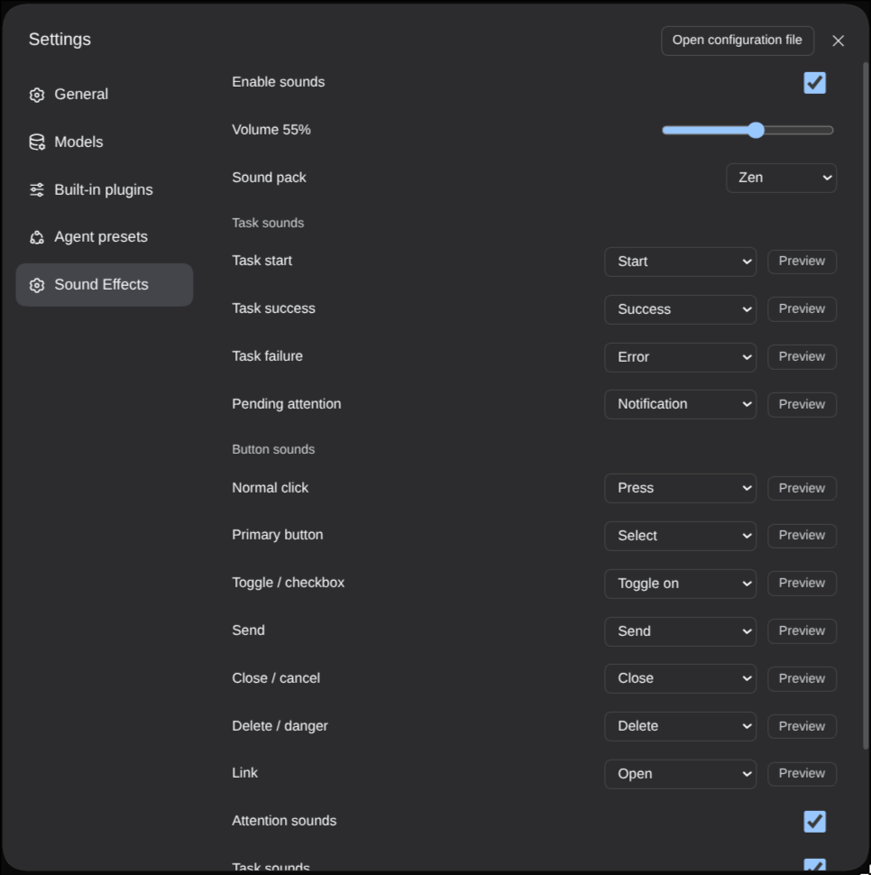

# 🔊 dsh-plugin-uisfx

> A dsh plugin that brings [uisfx](https://uisfx.com) semantic UI sound effects to DeepSeek Harness.
> Task start / success / failure and button clicks can each be assigned a sound cue from the settings page, with instant preview.

> **Revived fork — updated for current dsh.** Upstream
> [XanthanL/dsh-plugin-uisfx](https://github.com/XanthanL/dsh-plugin-uisfx) has been dormant since
> 2026-08-29, and its last npm release (`0.1.1`, August 2026) targets dsh 0.1.x — current dsh refuses it.
> This fork brings the plugin up to **dsh 0.2.0-rc.2** and is the maintained version. See [Upstream](#upstream).

[](#license)
[](https://github.com/XanthanL/dsh-plugin-uisfx)
[](https://github.com/topics/dsh-plugin)
[](https://github.com/deepseek-ai)
[](https://uisfx.com)

---

## What it solves

dsh has almost no audio feedback by default. Did the task finish? Did it fail? Did the button register? You can only tell by watching the screen.

`dsh-plugin-uisfx` adds a **semantic sound system**:

- **Task sounds** — start, success, failure, pending attention
- **Button sounds** — different sounds for different button kinds
- **Global sound packs** — 12 uisfx packs, switch the whole personality in one click
- **Per-scenario cues** — every scenario maps to an independent cue, with preview buttons
- **Persistent settings** — stored in `settings.yaml`, survives restarts

---

## Preview



---

## Quick start

Install straight from GitHub — no npm package is published for this fork:

```powershell
dsh plugin --profile web add github:olegedly/dsh-plugin-uisfx
# restart dsh web
```

Pin a commit for a reproducible install:

```powershell
dsh plugin --profile web add github:olegedly/dsh-plugin-uisfx#<commit-sha>
```

Then open **Settings → Sound Effects**.

> Requires dsh `0.2.0-rc.2` (the current release).
>
> ⚠️ Do not install the npm package `dsh-plugin-uisfx` on dsh 0.2. Its newest version is `0.1.1` from
> August 2026, it targets dsh 0.1.x, and dsh rejects it on compatibility grounds before installing.

---

## Features

| Feature | Description |
|---|---|
| 🎚 Global sound pack | 12 uisfx packs (`zen` / `studio` / `scifi` / `soft` ...) |
| 🎯 Scenario mapping | 11 scenarios, each mapped to a cue with sensible defaults |
| ▶ Instant preview | Preview buttons next to every scenario in settings |
| 🔔 Task feedback | Start / success / failure / pending for the current session |
| 🖱 Button feedback | Auto-detects send / delete / toggle / link / primary / normal |
| 💾 Persistence | Host `settings.yaml` namespace `uisfx` (the profile entry id) |
| 🔌 Service API | `ctx.uisfx` for third-party plugins |

---

## Default scenario mapping

| Scenario | Cue | When |
|---|---|---|
| `task.start` | `start` | agent starts running |
| `task.success` | `success` | task finishes successfully |
| `task.failure` | `error` | task fails |
| `task.pending` | `notification` | pending interaction appears |
| `click.normal` | `press` | normal button |
| `click.primary` | `select` | primary / accent button |
| `click.toggle` | `toggle-on` | toggle / checkbox |
| `click.send` | `send` | send / submit |
| `click.close` | `close` | close / cancel |
| `click.danger` | `delete` | delete / destructive action |
| `click.link` | `open` | link |

Default sound pack: `zen` — paper, wood and quiet chimes for long working sessions.

---

## Sound packs

| Pack | Character | Good fit |
|---|---|---|
| `minimal` | Dry, precise | Productivity |
| `soft` | Rounded, warm | Mobile, friendly SaaS |
| `glass` | Bright, crystalline | Media, finance |
| `arcade` | Chunky pixels | Games |
| `mechanical` | Switches, relays | Devtools |
| `organic` | Wood, water | Education, kids |
| `dreamy` | Airy, slow | Creative tools |
| `scifi` | Holographic | AI tools |
| `rubber` | Elastic, playful | Casual apps |
| `cinematic` | Deep impacts | Media, games |
| `studio` | Tactile, restrained | AI creative tools |
| `zen` | Paper, wood, chime | Focus, reading (default) |

Preview every pack: https://uisfx.com

---

## Settings

| Setting | Default | Description |
|---|---|---|
| `enabled` | `true` | Master switch |
| `volume` | `0.55` | Volume 0-1 |
| `pack` | `zen` | Global sound pack |
| `taskSounds` | `true` | Task sounds |
| `clickSounds` | `true` | Button sounds |
| `attentionSounds` | `true` | Pending attention sounds |
| `mapping.*` | table above | Per-scenario cue |

All settings are written to Host `settings.yaml`:

```yaml
uisfx:
  enabled: true
  volume: 0.55
  pack: zen
```

---

## Service API

Other dsh plugins can trigger sounds:

```ts
// play by scenario
ctx.uisfx.play('task.success')
ctx.uisfx.play('click.send')
ctx.uisfx.play('task.start')

// play a raw cue
ctx.uisfx.playCue('achievement')
ctx.uisfx.playCue('reward')

// preview from settings
ctx.uisfx.preview('success')

// read / update settings
ctx.uisfx.getPrefs()
ctx.uisfx.setPack('studio')
ctx.uisfx.setVolume(0.5)
```

There are 78 cues from uisfx:
`hover` / `press` / `select` / `toggle-on` / `send` / `success` / `error` / `complete` / `achievement` / ...

---

## Architecture

- **No audio files** — embeds the uisfx 0.4.0 Web Audio synthesis runtime
- **Lazy player** — created on the first user gesture, respecting autoplay policies
- **Task watcher** — tracks `uiSession.current` and reads `running` / `pendingInteraction` per session from `uiSession.sessionStatus` (dsh 0.2 moved both out of `ctx.sessions.list`)
- **Click classifier** — global pointerdown classifier maps semantics to scenarios
- **Persistence** — dedicated `/uisfx/api/settings` API backed by Host settings

---

## FAQ

### No sound?

1. Settings → Sound Effects → enable sounds
2. The browser may block autoplay: click anywhere on the page once
3. Check the system volume and the dsh volume slider

### No success / failure sound after a task?

- Only the **current session** plays task sounds
- Make sure `taskSounds` is enabled
- Failure detection uses `lastAgentError` or `turn-error` nodes

---

## Development

```powershell
git clone https://github.com/olegedly/dsh-plugin-uisfx.git
cd dsh-plugin-uisfx
pnpm install
pnpm build      # generates lib/client.js / lib/index.js
pnpm check      # syntax checks
pnpm test       # drives the real client bundle through a simulated dsh 0.2 turn
```

`scripts/build.mjs` is the source of truth: it generates `package.json`, `cordis.patch.yml`, `lib/index.js`,
`lib/client.js` and `vendor/uisfx-0.4.0.js`. Edit the generator and re-run `pnpm build` rather than
hand-editing the generated files.

Use a separate dev profile so restarts never interrupt your daily web:

```powershell
dsh plugin --profile dev add /absolute/path/to/dsh-plugin-uisfx
dsh --profile dev --port 3090
```

Browser debug helpers:

```js
window.__dshUISFX()          // uisfx player
window.__dshUISFXDebug()     // current prefs
```

---

## Roadmap

- [x] Task sounds + button sounds + settings UI + persistence
- [x] All 12 packs and 78 cues selectable
- [ ] Background-session completion notifications
- [ ] Hover / drag / split sounds
- [ ] Per-scenario sound pack
- [ ] Custom audio uploads

---

## Upstream

Upstream [XanthanL/dsh-plugin-uisfx](https://github.com/XanthanL/dsh-plugin-uisfx) has been dormant since
**2026-08-29**. Its entire history is a two-week burst in August 2026, it has no tagged releases, and its npm
package only ever shipped `0.1.0` / `0.1.1` for dsh 0.1.x. dsh then moved on to `0.2.0-rc.2`, which removed
`ctx.settings.register()`, dropped `@deepseek-ai/dsh-client-runtime`, and moved the current-session facts out
of `ctx.sessions.list` — so the upstream plugin no longer installs, and would not work if it did.

This fork is the continuation of that work:

| Version | Change |
|---|---|
| `0.2.0` | Ported to the dsh 0.2 settings model and client injects |
| `0.2.1` | Fixed the task-lifecycle watcher, which had gone silent on dsh 0.2 |

Details are in [CHANGELOG.md](CHANGELOG.md). Upstream is kept as a git remote for reference:

```powershell
git remote add upstream https://github.com/XanthanL/dsh-plugin-uisfx.git
```

Because upstream is dormant, please file issues and pull requests **here** rather than upstream.

---

## License

- This plugin: MIT
- Embedded uisfx runtime: MIT, copyright Yuki Capital — see [`NOTICE`](NOTICE) and [`vendor/uisfx-0.4.0.js`](vendor/uisfx-0.4.0.js)

## Related projects

- [uisfx](https://github.com/romainsimon/uisfx) — the open-source sound system this plugin uses
- [DSH-better-sidebar](https://github.com/omdsh-dev/DSH-better-sidebar) — a powerful dsh sidebar plugin
- [dsh-navbar](https://github.com/vlln/dsh-navbar) — conversation message navigation dots

---

If this plugin saves you from staring at the screen waiting for a task, give it a ⭐.

